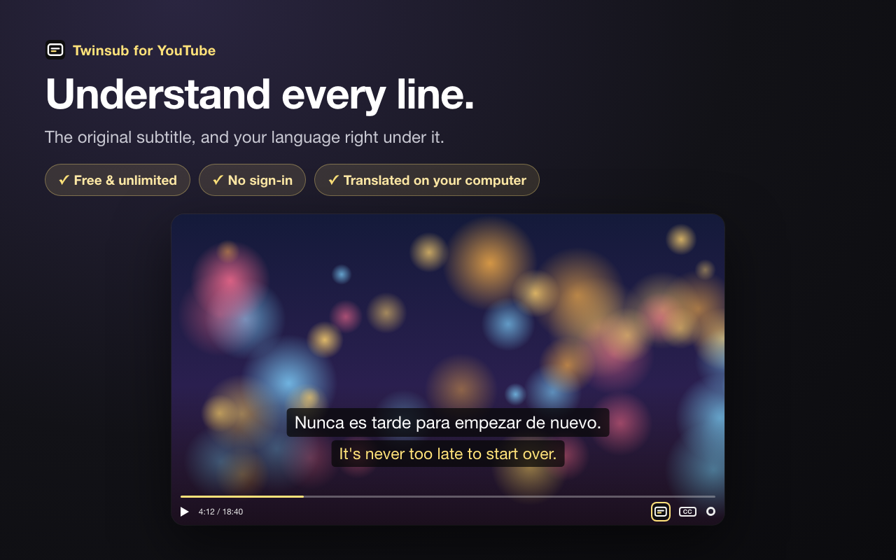

# Twinsub

Dual subtitles for YouTube™: the original line, and the same line in your language right underneath.
Translated on your own computer by Chrome's built-in Translator. Free, no sign-in, nothing leaves the browser.



## How it works

- `src/page.js` runs in the page and picks up the caption files the YouTube player already downloads (`/api/timedtext`), plus the player's current track.
- `src/captions.js` turns them into cues; auto-generated captions are regrouped into sentences.
- `src/content.js` translates the cues with the [Translator API](https://developer.chrome.com/docs/ai/translator-api) and draws the second line over the video.
- `popup/` holds the settings.

Needs Chrome 138 or newer on a desktop.

## Develop

Load the folder as an unpacked extension (`chrome://extensions` → Developer mode → Load unpacked).

```
npm test          # caption parsing
npm run build     # dist/twinsub-<version>.zip for the Chrome Web Store
```

The store screenshots and promo tiles are rendered from `store/copy/<locale>.json` by `scripts/store-assets.cjs`;
`scripts/locales.cjs` writes `_locales` from the same files. Both need Playwright (set `PLAYWRIGHT_DIR` to a `node_modules` that has it).

## Privacy

See [PRIVACY.md](PRIVACY.md), also published at https://twinsub.poeticalengine.com/privacy/.

YouTube is a trademark of Google LLC. Twinsub is not affiliated with or endorsed by YouTube or Google.

© 2026 Poetical Engine LLC. All rights reserved.

## Source code

The source is published so anyone can check what Twinsub does with their data, for example that subtitles are translated on the device and that only an Explain request reaches our server. It is not open source: there is no license to copy, modify or redistribute it. Questions or security reports: hello@poeticalengine.com.

## Website

`site/` builds the landing site at https://twinsub.poeticalengine.com (10 languages, llms.txt, sitemap). `node site/build.mjs` writes `site/dist`; deploy with wrangler from `site/`. Set `cws` in `site/config.json` once the store listing is live.
